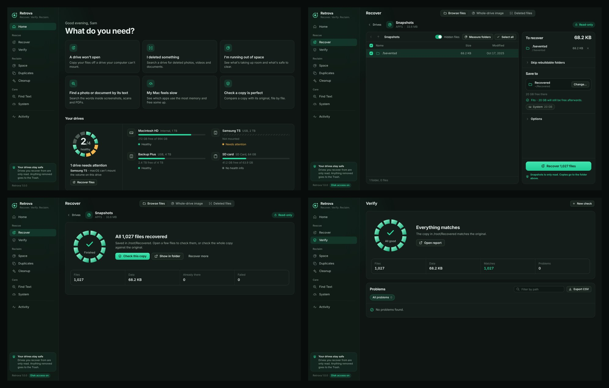
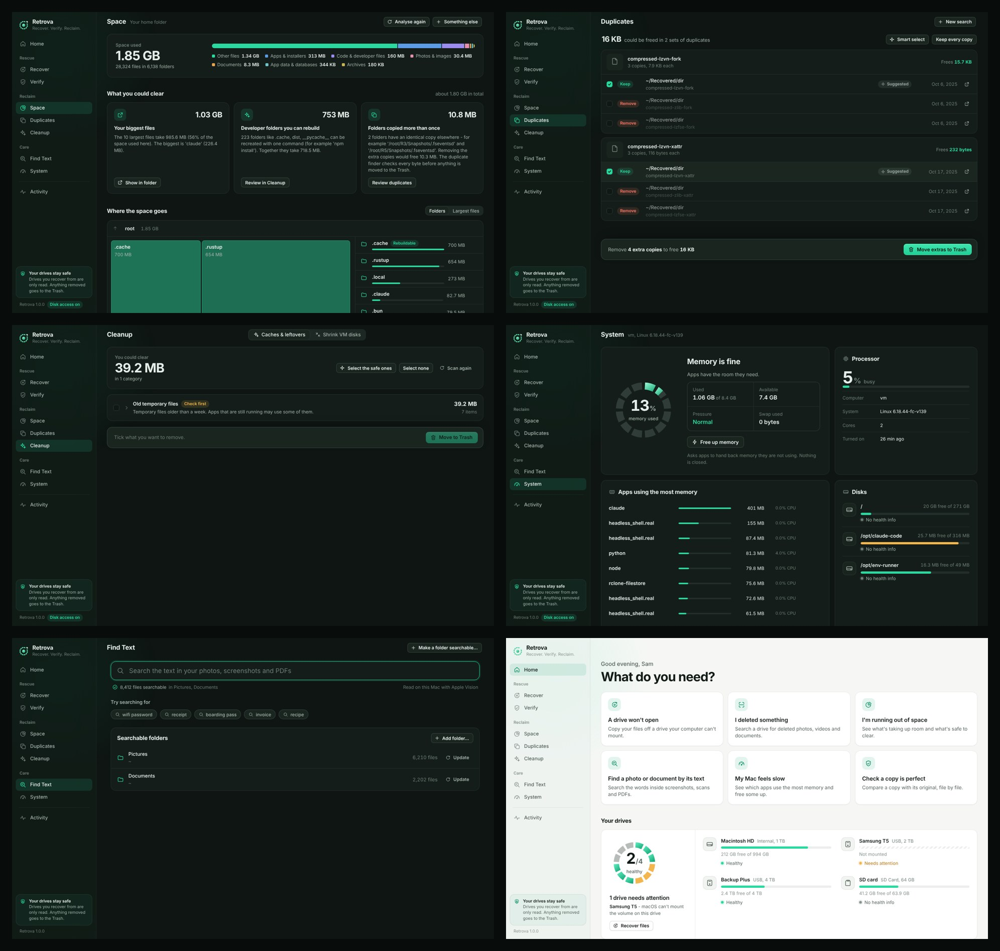
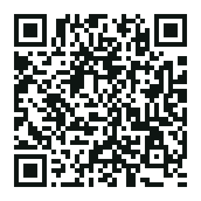

# Retrova

<p align="center">
  
</p>

<h3 align="center">Recover. Verify. Reclaim.</h3>

<p align="center">
  A free, open-source, local-only desktop app for macOS and Windows that gets your files off damaged or unmountable drives without ever writing to them, proves every copy is byte-for-byte identical, and helps you reclaim disk space.
</p>

<p align="center">
  <a href="https://github.com/jishnumahanta/retrova/releases/tag/v1.0.2"></a>
  <a href="#downloads"></a>
  
  
  <a href="LICENSE"></a>
  <a href="#-support-retrova"></a>
</p>

---

## 📸 Screenshots

<p align="center">
  
  <br>
  <em>Rescue Dashboard: Drive health monitor, APFS-aware browsing, recovery stats, and byte-for-byte verification.</em>
</p>

<p align="center">
  
  <br>
  <em>Disk Care & Reclaim: Interactive space treemap, APFS-clone duplicate finder, smart cleanup, system monitor, and local OCR search.</em>
</p>

---

## ⬇️ Downloads (v1.0.2)

| Platform | Download | Architecture | Size |
| :--- | :--- | :--- | :--- |
| **macOS** | [**`Retrova-1.0.2-mac-arm64.dmg`**](https://github.com/jishnumahanta/retrova/releases/download/v1.0.2/Retrova-1.0.2-mac-arm64.dmg) | Apple Silicon (M1, M2, M3, M4+) | 18 MB |
| **macOS** | [**`Retrova-1.0.2-mac-x64.dmg`**](https://github.com/jishnumahanta/retrova/releases/download/v1.0.2/Retrova-1.0.2-mac-x64.dmg) | Intel 64-bit | 18 MB |
| **Windows** | [**`Retrova-1.0.2-win-x64-Setup.exe`**](https://github.com/jishnumahanta/retrova/releases/download/v1.0.2/Retrova-1.0.2-win-x64-Setup.exe) | Windows 10 & 11 (Installer) | 14 MB |
| **Windows** | [**`Retrova-1.0.2-win-x64-portable.zip`**](https://github.com/jishnumahanta/retrova/releases/download/v1.0.2/Retrova-1.0.2-win-x64-portable.zip) | Windows 10 & 11 (Portable, no install) | 24 MB |

Check the official SHA-256 checksums in [**`SHA256SUMS`**](https://github.com/jishnumahanta/retrova/releases/download/v1.0.2/SHA256SUMS) to verify download integrity.

---

## 🛡️ Core Safety Invariants

1. **Strictly Read-Only**: Source drives are opened exclusively with read-only system handles. No recovery process ever writes, formats, partitions, or touches blocks on the damaged disk.
2. **Non-Destructive Deletions**: Deletions never execute permanent `rm`. All items cleaned or de-duplicated are moved to your operating system's Trash or Recycle Bin.
3. **Collision Safe**: Staged files are written as `.part` and renamed once verified. Collisions are preserved as `filename.retrova-N`.
4. **Zero Telemetry / Air-Gapped**: Retrova binds exclusively to `127.0.0.1` using a cryptographic session token. It never connects to the internet by itself or sends analytics. The only exception is **Check for updates**, which asks GitHub for the latest version when you click it.

---

## ⚡ What Retrova Does

### 🛟 Rescue
* **Unmountable Drive Recovery**: Direct block-level parser for damaged or unmountable partitions:
  * **APFS** (reads the newest usable checkpoint, compressed files and forks `zlib`/`lzvn`/`lzfse`, and tolerates a corrupted catalog tree; it does not browse APFS snapshots)
  * **NTFS**, **FAT12/16/32**, **exFAT**
  * **ext2/3/4**, **XFS**, **Btrfs**, and **GPT/MBR** partition table scanning.
* **Deleted-File Recovery With Names**: On **NTFS**, **FAT12/16/32** and **exFAT**, finds deleted files from the file system's own leftover records and brings them back with their original names and folders (files whose folder can't be traced go under "Lost folders"). Each is marked Good, Possibly overwritten or May be incomplete. FAT can't know if a file was fragmented, so it is read as one unbroken stretch. Not available for APFS, ext or other file systems, and on NTFS files that were compressed or encrypted, or whose details are spread over several records, aren't listed (Retrova says how many).
* **Deep File Carving**: Extracts **45 file formats** directly from raw block devices without filesystem metadata. Header-and-structure validation rejects false positives.
* **Sector-Safe Disk Imaging**: Creates raw bit-for-bit `.img` disk images with bad-sector skipping and sparse zero-block detection.

### 🔍 Verify & Repair
* **Byte-for-Byte Comparison**: Compares recovered copies directly against the original drive blocks in **Quick** (name & size), **Sample** (64KB head/tail hash), or **Full** (byte-for-byte) mode.
* **Audit Manifests & One-Click Repair**: Generates CSV problem logs and SHA-256 manifests; automatically recopies mismatched files.

### 🧹 Reclaim
* **Sparse File Reclaim (Docker / Colima / VMs)**: Fixes the file-bloat issue where virtual disks expand to their maximum virtual limit upon recovery. Shrinks files back to their physical allocated size using native sparse filesystem holes.
* **APFS Duplicate Cloning**: Byte-exact duplicate finder. On macOS, duplicates can be turned into **APFS Clones** (Copy-on-Write) instantly freeing disk space while keeping both files visible in Finder.
* **Smart Dev Cleanup**: Identifies regenerable development caches (`node_modules`, `.pnpm-store`, `.venv`, `.next`, `DerivedData`) with exact commands to rebuild them.
* **Local OCR Search**: Apple Vision (macOS) and WinRT OCR (Windows) local text indexing into an offline SQLite FTS5 database to search screenshots and photos by keyword. PDFs are searched by their text layer only (macOS PDFKit, or `pdftotext` on Windows/Linux); scanned PDF pages are not OCR'd.

---

## 🚀 Installation & First Launch

### macOS (Apple Silicon & Intel)
1. Download either [`Retrova-1.0.2-mac-arm64.dmg`](https://github.com/jishnumahanta/retrova/releases/download/v1.0.2/Retrova-1.0.2-mac-arm64.dmg) (Apple Silicon) or [`Retrova-1.0.2-mac-x64.dmg`](https://github.com/jishnumahanta/retrova/releases/download/v1.0.2/Retrova-1.0.2-mac-x64.dmg) (Intel).
2. Open the DMG and drag **Retrova.app** into `/Applications`.
3. Because Retrova is independently ad-hoc signed, macOS Gatekeeper may show a notice on first launch:
   * Double-click **Retrova** in Applications, then click **Done**.
   * Open **System Settings $\rightarrow$ Privacy & Security**.
   * Scroll down to the security section and click **Open Anyway**.
4. *(Recommended for raw disk recovery)*: In **System Settings $\rightarrow$ Privacy & Security $\rightarrow$ Full Disk Access**, enable Retrova to allow reading unmountable raw block devices (`/dev/rdisk*`).

### Windows 10 & 11
1. Download [`Retrova-1.0.2-win-x64-Setup.exe`](https://github.com/jishnumahanta/retrova/releases/download/v1.0.2/Retrova-1.0.2-win-x64-Setup.exe) (or the portable zip).
2. Run the installer.
3. If Windows SmartScreen displays a blue protection banner:
   * Click **More info**.
   * Click **Run anyway**.

---

## 🔐 Verifying Download Integrity

To verify that your downloaded file matches the official cryptographic release:

### On macOS / Linux:
```bash
shasum -a 256 Retrova-1.0.2-mac-arm64.dmg
```

### On Windows (PowerShell):
```powershell
Get-FileHash Retrova-1.0.2-win-x64-Setup.exe -Algorithm SHA256
```

Compare the output against the values in [`SHA256SUMS`](https://github.com/jishnumahanta/retrova/releases/download/v1.0.2/SHA256SUMS):
```text
8655d5be8e97217e86e4265136257a9574c3728c91f0666a7659e67de7935a13  Retrova-1.0.2-mac-arm64.dmg
33ee26dd3c437705451c74ac9aa985ef351011302fe982dbe617ca77871e1777  Retrova-1.0.2-mac-x64.dmg
46ef83b61206edcd0e948fe489e2c24344eeefca9f316f499f3f38a8dcc471cf  Retrova-1.0.2-win-x64-Setup.exe
33af56c759041bbd9cd8da9eceeb6888e1d1663900013b6df2d687da4627e48c  Retrova-1.0.2-win-x64-portable.zip
```

---

## 🧩 Build from source

Retrova is plain Python with a no-build-step web UI.

```bash
python3 -m venv .venv && source .venv/bin/activate
pip install -r packaging/requirements/common.txt -r packaging/requirements/mac.txt   # or win.txt
python -m retrova                                            # opens the app window
python -m retrova --serve-only --port 8930 --token dev       # engine only: http://127.0.0.1:8930/?t=dev
```

Add `&mock=1` to the URL to try the interface without touching any drive.

Run the tests with `pip install pytest pillow && python -m pytest tests`. The release builds (`packaging/build_all.sh`) need a Debian/Ubuntu x86_64 host. See [SPEC.md](SPEC.md) for how the engine and UI fit together.

---

## 💚 Support Retrova

Retrova is free for everyone rescuing their own files, and it will stay that way. If it saved your photos, your work or your weekend, you can help keep it going:

| | How |
| :--- | :--- |
| 🇮🇳 **UPI (India)** | Pay `jishnumahanta17@oksbi` from any UPI app, or scan the QR code below |
| 🌍 **Wise (anywhere)** | [wise.com/pay/business/jishnumahanta](https://wise.com/pay/business/jishnumahanta): card or bank transfer in your currency |
| 💚 **GitHub Sponsors** | [github.com/sponsors/jishnumahanta](https://github.com/sponsors/jishnumahanta) |

<p></p>

The app has the same options under **Support Retrova** in the sidebar. Paying unlocks nothing: every feature is already free.

Starring the repo and telling one friend also helps more than you'd think.

---

## 📜 License

Retrova is free software: Copyright © 2026 Jishnu Mahanta, licensed under the [GNU Affero General Public License v3.0](LICENSE). You can use, study, share and modify it under those terms. It comes with **no warranty**.

The name "Retrova" and the Retrova logo are trademarks of Jishnu Mahanta. Forks are welcome, but please give them a different name and icon. Bundled libraries keep their own licences: see [THIRD_PARTY_NOTICES.md](THIRD_PARTY_NOTICES.md).

---

## 👤 Author

Designed and built by **Jishnu Mahanta** ([jishnumahanta.in](https://jishnumahanta.in)).

* Website: [retrova.jishnumahanta.in](https://retrova.jishnumahanta.in)
* Releases: [github.com/jishnumahanta/retrova/releases](https://github.com/jishnumahanta/retrova/releases)
* Privacy & Security: See [SECURITY.md](SECURITY.md)
* Installation Details: See [INSTALL.md](INSTALL.md)
